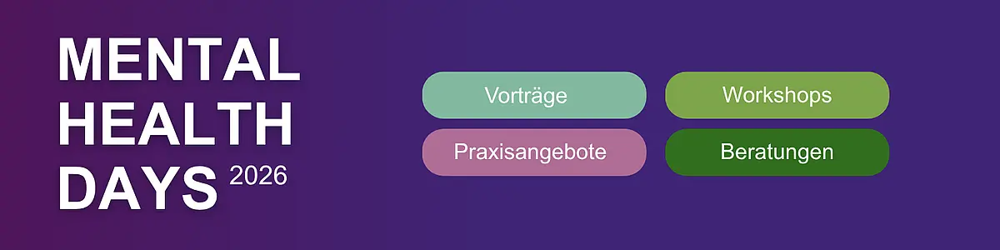
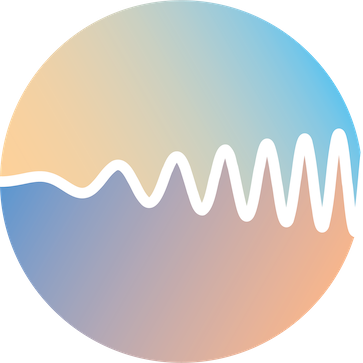
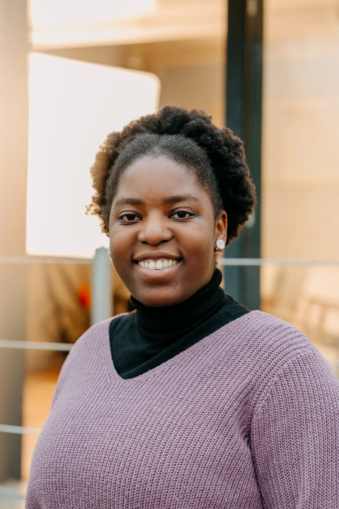
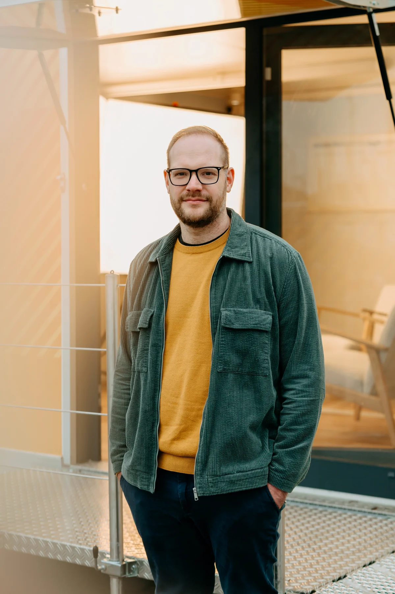
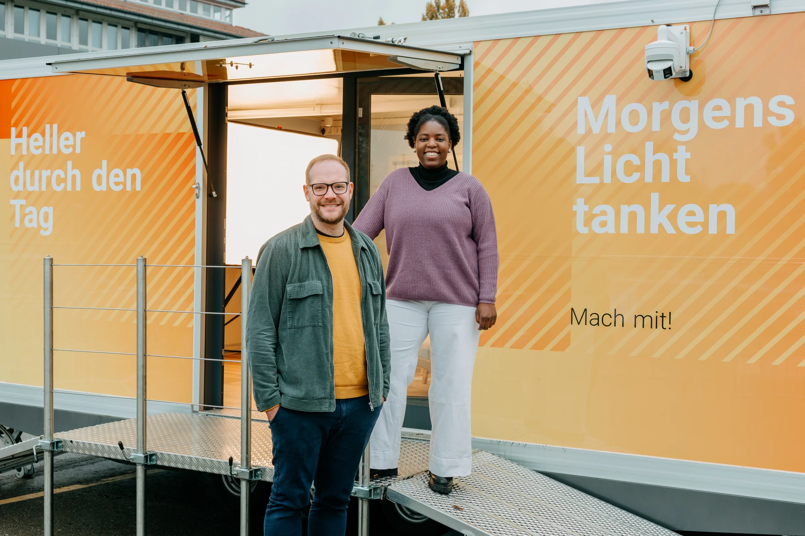
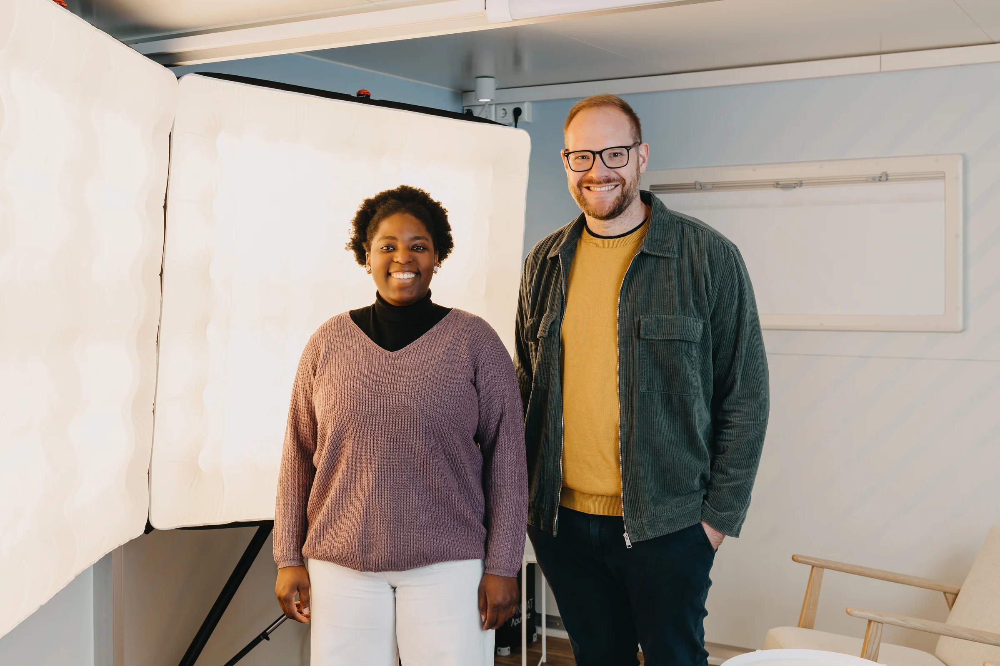

```{=html}
<section class="science-hero section"><p class="eyebrow">THE LIGHT CAFÉ · SCIENTIFIC BACKGROUND</p><h1><span class="headline-line">The Light Café:</span> <span class="headline-line">a field study of</span> <span class="headline-line headline-light">morning light.</span></h1><p>An adaptive field study of morning light exposure, circadian phase, sleep and cognition in Tübingen, Germany.</p><a class="button" href="#design">Study design <span aria-hidden="true">↓</span></a></section>
<div class="facts-bar"><div><span class="fact-label">SETTING</span><span>Europaplatz, Tübingen<small>At the main railway station</small></span></div><div><span class="fact-label">OPENING</span><span>19 November 2026<small>The Light Café opens</small></span></div><div><span class="fact-label">STUDY</span><span>From 30 November 2026<small>Start of the study phase</small></span></div></div>
<section class="section" id="research"><p class="section-kicker">01 / THE RESEARCH QUESTION</p><div class="intro-layout"><h2>How does morning light<br>affect circadian timing?</h2><div class="intro-text"><p class="lead">How do light intensity and spectral composition shape the human circadian response in everyday settings?</p><p>The Light Café is a field study combining controlled morning light exposure with circadian, behavioural and subjective outcome measures. It asks how responses vary across light conditions and between individuals.</p><p>The mobile research trailer at Europaplatz, by Tübingen’s main railway station, serves as both an intervention space and a meeting place for researchers and the public. The Light Café opens on 19 November 2026; the study phase begins on 30 November 2026.</p><p>The long-term aim is to inform biologically grounded, more personalised light interventions. These are research objectives, not established outcomes of this project.</p></div></div></section>
<section class="section process-section" id="design"><p class="section-kicker">02 / STUDY DESIGN</p><div class="section-heading"><h2>The study<br>at a glance.</h2><p>Sequential cohorts with light conditions<br>adapted in response to previous observations.</p></div><div class="study-facts"><div><strong>10</strong><span>weekday sessions<br>per participant</span></div><div><strong>60</strong><span>minutes per session<br>over two weeks</span></div><div><strong>144–192</strong><span>target participants<br>across 6–8 cohorts</span></div></div><ol class="steps"><li><span class="step-label">BASELINE</span><h3>Baseline<br>measurements</h3><p>Assess circadian phase with dim-light melatonin onset (DLMO), alongside actigraphy and cognitive performance measures.</p></li><li><span class="step-label">INTERVENTION</span><h3>Morning light<br>sessions</h3><p>Ten one-hour sessions on weekdays, within four daily time windows between 07:00 and 11:00. Light intensity and spectral composition are controlled.</p></li><li><span class="step-label">FOLLOW-UP</span><h3>Repeat assessments<br>and analyse the data.</h3><p>Repeat the assessments and collect subjective tiredness and well-being measures. Analyse each cohort to inform subsequent light conditions.</p></li></ol><p class="process-note">The recruitment target is up to six participants per time window and up to 24 per cohort. The sample range is an operational recruitment estimate, not a reported power calculation or an achieved sample. Exact light settings, eligibility criteria, allocation procedures and adaptation rules are not yet specified here.</p></section>
<section class="section methods-section" id="methods"><p class="section-kicker">03 / OUTCOME DOMAINS</p><div class="intro-layout"><div><h2>What we<br>measure.</h2><p class="section-aside">Circadian, behavioural<br>and subjective measures.</p></div><dl class="methods-list"><div><dt>Circadian phase <span>DLMO</span></dt><dd>Timing of the evening rise in melatonin under dim-light conditions, measured before and after the intervention.</dd></div><div><dt>Sleep and activity <span>ACTIGRAPHY</span></dt><dd>Objective assessment of rest–activity patterns using a wearable sensor.</dd></div><div><dt>Cognition <span>PERFORMANCE</span></dt><dd>Tasks assessing cognitive performance and attention alongside the physiological measurements.</dd></div><div><dt>Daily experience <span>SELF-REPORT</span></dt><dd>Subjective tiredness and well-being following the intervention.</dd></div></dl></div></section>
<section class="section science-context"><div class="intro-layout"><h2>Research and<br><span>public engagement</span></h2><div><p class="lead">Visit the Light Café to experience light and get to know our research.</p><p>The public drop-in takes place on Friday, 20 November, and Monday–Friday, 23–27 November 2026, from 07:00 to 11:00 each day at Europaplatz, Tübingen. Visitors can attend this open programme before the study phase.</p><p>Three talks with Manuel Spitschan accompany the programme: 24 November 2026, 18:00–19:00 at Werkstadthaus in Tübingen; 1 December 2026, 13:00–14:00 online via Zoom; and 4 December 2026, 15:30–17:00 at the Hirsch-Begegnungsstätte, Hirschgasse 9, Tübingen. All three talks are in German. <a class="inline-link" href="../#veranstaltungen" hreflang="de">Event details, registration and flyers <span aria-hidden="true">↗</span></a></p>
<p>Our Lunch Bytes talk on 1 December is part of Mental Health Days 2026. <a href="https://uni-tuebingen.de/einrichtungen/zentrale-einrichtungen/hochschulsport/sgm-betabalance/mental-health-days-angebote/" hreflang="de" class="programme-link">Explore the full programme on the University of Tübingen website (in German) <span aria-hidden="true">↗</span></a></p>
<a class="programme-banner programme-banner--inline" href="https://uni-tuebingen.de/einrichtungen/zentrale-einrichtungen/hochschulsport/sgm-betabalance/mental-health-days-angebote/" hreflang="de"></a>
<p>The trailer was previously used for the “Nachtmensch oder Frühaufsteher?” science roadshow, which is no longer active. Its former website remains available as an archive. <a class="inline-link" href="https://roadshow.tscnlab.org/" hreflang="de">Archived Roadshow website (in German) <span aria-hidden="true">↗</span></a></p>
<p>The Light Café project investigates methods for adaptive field interventions and how light conditions relate to circadian, sleep and cognitive outcomes.</p><a class="inline-link" href="../assets/lichtmobil-projekt-a5.pdf" type="application/pdf" hreflang="de">Project flyer (PDF, in German) <span aria-hidden="true">↗</span></a></div></div></section>
<section class="section team-section" id="team" aria-labelledby="team-title">
  <p class="section-kicker">04 / TEAM & SCIENTIFIC CONTACT</p>
  <div class="intro-layout">
    <div>
      <h2 id="team-title">Study team</h2>
      <p class="section-aside">Max Planck Institute for<br>Biological Cybernetics, Tübingen</p>
      <a class="lab-signature" href="https://www.tscnlab.org/" aria-label="tSCN Lab – Research group website"><span>tSCN Lab <span aria-hidden="true">↗</span></span></a>
    </div>
    <div>
      <p class="lead">A project of the Translational Sensory and Circadian Neuroscience research group.</p>
      <p class="team-copy">At the Max Planck Institute for Biological Cybernetics in Tübingen, we investigate how light influences human physiology and behaviour.</p>
      <div class="team-links"><a href="https://www.tscnlab.org/">TSCN Lab <span aria-hidden="true">↗</span></a><a href="https://www.kyb.tuebingen.mpg.de/614159/translational-sensory-and-circadian-neuroscience">Research group <span aria-hidden="true">↗</span></a><a href="https://www.tum.de/en/">Technical University of Munich <span aria-hidden="true">↗</span></a></div>
    </div>
  </div>
  <p class="team-members"><strong>Prof. Dr. Manuel Spitschan</strong> leads the project. <strong>Chikondano Daza</strong> is a research associate on the team.</p>
  <div class="team-people">
    <figure class="team-portrait">
      <a class="team-photo-link" href="../assets/photos/portrait-011.webp" aria-label="Open the full photograph"></a>
      <figcaption>Photo: Verena Müller</figcaption>
    </figure>
    <figure class="team-portrait">
      <a class="team-photo-link" href="../assets/photos/portrait-019.webp" aria-label="Open the full photograph"></a>
      <figcaption>Photo: Verena Müller</figcaption>
    </figure>
  </div>
  <div class="team-group-gallery">
    <figure class="team-scene">
      <a class="team-photo-link" href="../assets/photos/team-trailer.webp" aria-label="Open the full-size photograph of the team at the research trailer"></a>
      <figcaption>The team at the research trailer.<span>Photo: Verena Müller</span></figcaption>
    </figure>
    <figure class="team-scene">
      <a class="team-photo-link" href="../assets/photos/team-lichtcafe.webp" aria-label="Open the full-size photograph of the team in the Light Café"></a>
      <figcaption>The team in the Light Café.<span>Photo: Verena Müller</span></figcaption>
    </figure>
  </div>
</section>
<section class="signup-section section" id="contact"><div><p class="eyebrow">SCIENTIFIC ENQUIRIES</p><h2>Scientific<br>contact</h2></div><div class="signup-content"><p>For questions about the study or potential scientific collaboration, contact the scientific lead.</p><a class="button button-dark" href="mailto:manuel.spitschan@tuebingen.mpg.de?subject=Light%20Caf%C3%A9%20%E2%80%93%20scientific%20enquiry">Contact Manuel Spitschan <span aria-hidden="true">↗</span></a><p class="small"><a href="https://tuspl22-redcap.srv.mwn.de/redcap/surveys/?s=R839FPF3HNN8MP9L" data-signup>Register your interest in taking part</a>. Submitting this form does not confirm enrolment.</p><p class="small">For visits and participation: <a href="mailto:info@wasmachtlicht.de">info@wasmachtlicht.de</a> · <a href="../#mitmachen">Dates and participation information in German</a>.</p></div></section>
<aside class="source-note section"><p><strong>About this page.</strong> Opening, drop-in and study-start dates are taken from the <a href="../assets/lichtmobil-projekt-a5.pdf" type="application/pdf" hreflang="de">project flyer (PDF, in German)</a>. The scientific overview is based on the project’s research description. Detailed participation information and individual study appointments will be provided before enrolment.</p><p><strong>Further reading.</strong> <a href="https://www.kyb.tuebingen.mpg.de/614159/translational-sensory-and-circadian-neuroscience">Research themes and methods at the Max Planck Institute for Biological Cybernetics</a> · <a href="https://www.tscnlab.org/">TSCN Lab</a>.</p></aside>
```
