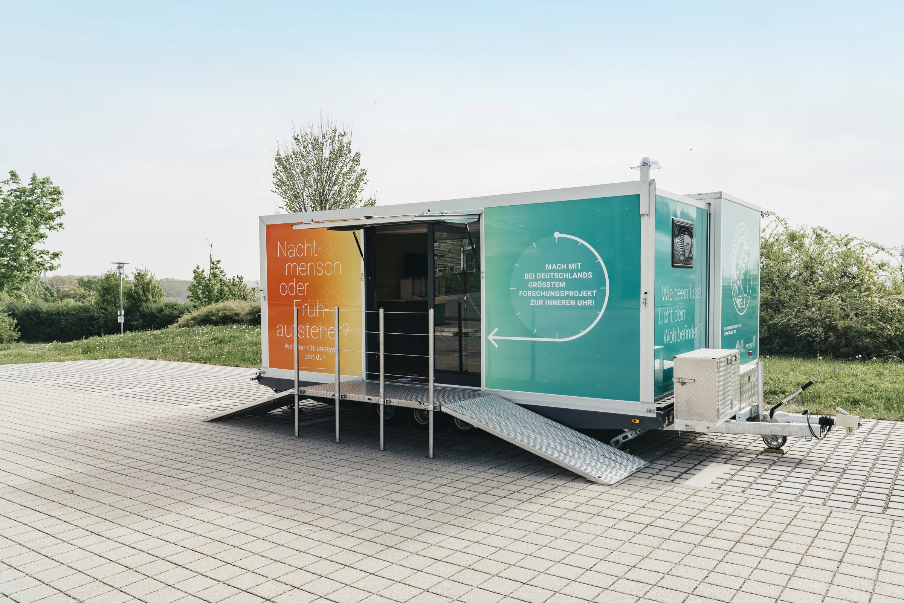
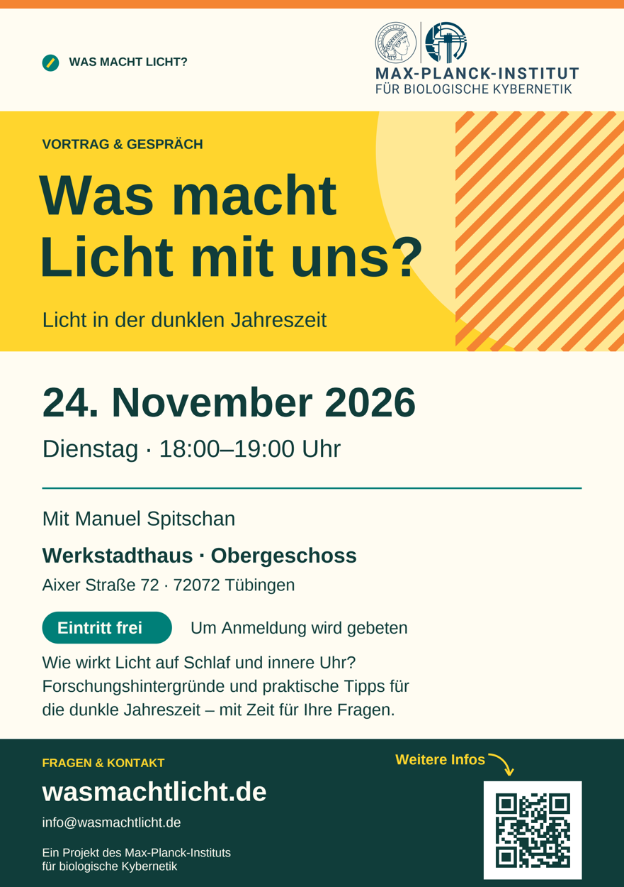
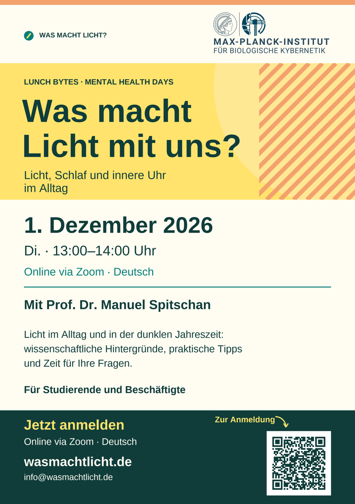
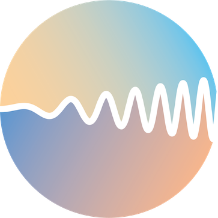

```{=html}
<section class="hero" aria-labelledby="hero-title">
  <div class="hero-copy"><p class="eyebrow">DAS LICHTCAFÉ · TÜBINGEN</p><h1 id="hero-title"><span class="headline-line">Was macht</span> <span class="headline-line"><span class="word-light">Licht</span> mit dir?</span></h1><p class="hero-description">Im Lichtcafé in Tübingen untersuchen wir, wie morgendliches Licht unsere innere Uhr, unseren Schlaf und unsere Aufmerksamkeit beeinflusst.</p><div class="hero-actions"><a class="button" href="#mitmachen">Besuch & Teilnahme <span aria-hidden="true">→</span></a><a class="text-link" href="#veranstaltungen">Veranstaltungen <span aria-hidden="true">↓</span></a></div><p class="hero-note">Ein Projekt des Max-Planck-Instituts für biologische Kybernetik.</p></div>
  <figure class="hero-image"><figcaption>Der mobile Forschungstrailer der Wissenschaftsroadshow.<span>Foto: Verena Müller</span></figcaption></figure>
</section>
<div class="facts-bar" aria-label="Das Projekt auf einen Blick"><div><span class="fact-label">WO?</span><span>Europaplatz, Tübingen<small>Am Hauptbahnhof</small></span></div><div><span class="fact-label">ERÖFFNUNG</span><span>19. November 2026<small>Das Lichtcafé öffnet</small></span></div><div><span class="fact-label">STUDIE</span><span>Ab 30. November 2026<small>Beginn der Studienphase</small></span></div></div>
<section class="section intro-section" id="lichtcafe"><div class="section-kicker">01 / DAS PROJEKT</div><div class="intro-layout"><h2>Lichtforschung.<br><span class="muted">Mitten in Tübingen.</span></h2><div class="intro-text"><p class="lead">Im Winter bekommen wir weniger Tageslicht. Was gezieltes Licht am Morgen bewirkt, möchten wir genauer verstehen.</p><p>Das Lichtcafé am Europaplatz in Tübingen verbindet Lichtforschung mit einem offenen Angebot zum Kennenlernen. Es eröffnet am 19. November 2026. In unserem mobilen Forschungstrailer verbringen Studienteilnehmende über zwei Wochen jeden Werktag eine Stunde unter kontrollierten Lichtbedingungen.</p><p>Wir messen ihre innere Uhr, ihren Schlaf und ihre Aufmerksamkeit vor und nach dieser Zeit. Beim offenen Angebot kannst du schon vor der Studienphase Licht erleben und unsere Forschung kennenlernen.</p><a class="inline-link" href="https://nachtmensch-oder-fruehaufsteher.de/">Mehr zur bisherigen Wissenschaftsroadshow <span aria-hidden="true">↗</span></a></div></div></section>
<section class="light-questions section" aria-labelledby="questions-title"><div class="section-heading"><h2 id="questions-title">Was wir<br>untersuchen.</h2><p>Wir vergleichen unterschiedliche Lichtbedingungen<br class="desktop-break"> und erfassen, was sich dabei verändert.</p></div><div class="question-grid"><article><span class="topic-number">01</span><h3>Unsere innere Uhr</h3><p>Wie verändert morgendliches Licht den Takt unseres Körpers? Und welche Rolle spielen Helligkeit und Lichtfarbe?</p></article><article><span class="topic-number">02</span><h3>Unser Schlaf</h3><p>Wie verändern sich Schlaf und Aktivität im Alltag, wenn wir regelmäßig Licht zu einer bestimmten Tageszeit erhalten?</p></article><article><span class="topic-number">03</span><h3>Unsere Aufmerksamkeit</h3><p>Welche Veränderungen zeigen sich bei Konzentration, Müdigkeit und Wohlbefinden – und wie unterscheiden sie sich von Mensch zu Mensch?</p></article></div></section>
<section class="section process-section" id="ablauf"><p class="section-kicker">02 / SO LÄUFT’S AB</p><div class="section-heading"><h2>Zwei Wochen<br>im Lichtcafé.</h2><p>Die Studienphase beginnt am 30. November 2026.<br>Deine konkreten Termine erfährst du vor der Teilnahme.</p></div><div class="study-facts"><div><strong>2</strong><span>Wochen<br>Lichtintervention</span></div><div><strong>1</strong><span>Stunde täglich<br>an Werktagen</span></div><div><strong>7–11</strong><span>Uhr morgens<br>vier Zeitfenster</span></div></div><ol class="steps"><li><span class="step-label">VORHER</span><h3>Die Ausgangslage<br>erfassen.</h3><p>Zu Beginn erfassen wir deine innere Uhr, Schlaf- und Aktivitätsmuster sowie deine Aufmerksamkeit.</p></li><li><span class="step-label">IM LICHTCAFÉ</span><h3>Eine Stunde Licht<br>am Morgen.</h3><p>Du verbringst an zehn Werktagen jeweils eine Stunde im Lichtcafé. Helligkeit und spektrale Zusammensetzung des Lichts werden gezielt eingestellt.</p></li><li><span class="step-label">DANACH</span><h3>Die Messungen<br>wiederholen.</h3><p>Wir wiederholen die Messungen und fragen nach Müdigkeit und Wohlbefinden. So vergleichen wir die Zeit vor und nach der Lichtintervention.</p></li></ol><p class="process-note">Zusätzlich zu den zehn Lichtterminen finden Messungen vor und nach der Intervention statt. Details zu Aufwand, Voraussetzungen und Ablauf folgen vor der Teilnahme.</p></section>
<section class="section events-section" id="veranstaltungen" aria-labelledby="events-title">
  <p class="section-kicker">03 / VERANSTALTUNGEN</p>
  <div class="section-heading"><h2 id="events-title">Vorträge &amp;<br>Veranstaltungen</h2><p>Im Werkstadthaus und online: Manuel Spitschan spricht über Licht im Alltag und beantwortet Fragen.</p></div>
  <div class="event-list">
    <article class="event" aria-labelledby="werkstadthaus-title">
      <div class="event-date"><time datetime="2026-11-24"><span class="event-day">24</span><span class="event-month">November <span>2026</span></span></time><p>Dienstag<br><time datetime="2026-11-24T18:00:00+01:00">18:00</time>–<time datetime="2026-11-24T19:00:00+01:00">19:00 Uhr</time></p></div>
      <div class="event-copy">
        <p class="event-format">Vortrag &amp; Gespräch</p>
        <h3 id="werkstadthaus-title">Was macht Licht mit uns?</h3>
        <p class="event-subtitle">Licht in der dunklen Jahreszeit</p>
        <p class="event-description">Wie wirkt Licht auf Schlaf und innere Uhr? Forschungshintergründe und praktische Tipps für die dunkle Jahreszeit – mit Zeit für Ihre Fragen.</p>
        <p class="event-speaker">Mit Manuel Spitschan</p>
        <div class="event-venue"><p><strong>Werkstadthaus · Obergeschoss</strong><br>Aixer Straße 72 · 72072 Tübingen</p><a href="https://www.google.com/maps/search/?api=1&amp;query=Werkstadthaus%2C%20Aixer%20Stra%C3%9Fe%2072%2C%2072072%20T%C3%BCbingen">Auf Google Maps ansehen <span aria-hidden="true">↗</span></a></div>
        <div class="event-actions"><a class="button" href="mailto:info@wasmachtlicht.de?subject=Anmeldung%3A%20Vortrag%20im%20Werkstadthaus%20am%2024.%20November%202026">Anmeldung per E-Mail <span aria-hidden="true">↗</span></a><p>Eintritt frei<br>Um Anmeldung wird gebeten.</p></div>
      </div>
      <a class="event-flyer" href="./assets/events/werkstadthaus-24-nov-a5.png" type="image/png"><span>Flyer ansehen <span class="event-filetype">(PNG)</span> <span aria-hidden="true">↗</span></span></a>
    </article>
    <article class="event" aria-labelledby="lunch-bytes-title">
      <div class="event-date"><time datetime="2026-12-01"><span class="event-day">01</span><span class="event-month">Dezember <span>2026</span></span></time><p>Dienstag<br><time datetime="2026-12-01T13:00:00+01:00">13:00</time>–<time datetime="2026-12-01T14:00:00+01:00">14:00 Uhr</time></p></div>
      <div class="event-copy">
        <p class="event-format">Lunch Bytes · Mental Health Days</p>
        <h3 id="lunch-bytes-title">Was macht Licht mit uns?</h3>
        <p class="event-subtitle">Licht, Schlaf und innere Uhr im Alltag</p>
        <p class="event-description">Licht im Alltag und in der dunklen Jahreszeit: wissenschaftliche Hintergründe, praktische Tipps und Zeit für Ihre Fragen.</p>
        <p class="event-speaker">Mit Prof. Dr. Manuel Spitschan</p>
        <div class="event-venue"><p><strong>Online via Zoom · Deutsch</strong><br>Für Studierende und Beschäftigte</p></div>
        <div class="event-actions"><a class="button" href="https://eu02web.zoom-x.de/meeting/register/xG3GhkFjQfytnQmBr2CdsQ">Für Lunch Bytes anmelden <span aria-hidden="true">↗</span></a></div>
      </div>
      <a class="event-flyer" href="./assets/events/lunch-bytes-01-dez-a5.png" type="image/png"><span>Flyer ansehen <span class="event-filetype">(PNG)</span> <span aria-hidden="true">↗</span></span></a>
    </article>
  </div>
</section>
<section class="section faq-section" id="fragen"><div><p class="section-kicker">04 / HÄUFIGE FRAGEN</p><h2>Fragen zur<br>Teilnahme</h2><p class="section-aside">Die wichtigsten Informationen<br>zum Lichtcafé und zur Studie.</p></div><div class="faq-list"><details><summary>Kann ich schon mitmachen?</summary><div>Das Lichtcafé eröffnet am 19. November 2026. Das offene Angebot kannst du am Freitag, 20. November, sowie Montag bis Freitag, 23.–27. November 2026, jeweils von 07:00 bis 11:00 Uhr besuchen. Die Studienphase beginnt am 30. November 2026. Du kannst schon jetzt <a href="https://tuspl22-redcap.srv.mwn.de/redcap/surveys/?s=R839FPF3HNN8MP9L" data-signup>dein Interesse an der Studie anmelden</a>. Informationen zu den Teilnahmevoraussetzungen und deinen konkreten Studienterminen erhältst du vor einer Teilnahme.</div></details><details><summary>Wie viel Zeit sollte ich einplanen?</summary><div>Zur Studienteilnahme gehören zehn einstündige Lichttermine an Werktagen über zwei Wochen. Sie liegen morgens zwischen 7 und 11 Uhr. Dazu kommen Messungen vor und nach der Lichtintervention. Den vollständigen Zeitaufwand erläutern wir vor einer Teilnahme.</div></details><details><summary>Was wird in der Studie gemessen?</summary><div>Wir erfassen den Zeitpunkt des abendlichen Melatoninanstiegs als Marker der inneren Uhr. Dazu kommen Messungen von Schlaf und Aktivität mit einem tragbaren Sensor, Aufgaben zur Aufmerksamkeit sowie Fragen zu Müdigkeit und Wohlbefinden.</div></details><details><summary>Ist das eine medizinische Behandlung?</summary><div>Das Lichtcafé ist ein Forschungsprojekt. Wir untersuchen die biologischen Grundlagen von Lichtinterventionen und können keine individuelle Wirkung versprechen. Eine Studienteilnahme ersetzt keine ärztliche Beratung oder Behandlung.</div></details><details><summary>Wo finde ich das Lichtcafé?</summary><div>Du findest das Lichtcafé am Europaplatz in Tübingen, direkt am Hauptbahnhof. Die Eröffnung ist am 19. November 2026.</div></details><details><summary>Kann ich auch einfach mehr über Licht erfahren?</summary><div>Ja. Unser offenes Angebot (Drop-in) findet am 20. November und vom 23. bis 27. November 2026 jeweils von 07:00 bis 11:00 Uhr statt. Du kannst es vor der Studienphase besuchen, Licht erleben und unsere Forschung kennenlernen. Mehr zum Projekt findest du im <a href="./assets/lichtmobil-projekt-a5.pdf" type="application/pdf">Projektflyer (PDF)</a>. Entdecke auch die <a href="https://nachtmensch-oder-fruehaufsteher.de/">Wissenschaftsroadshow „Nachtmensch oder Frühaufsteher?“</a>.</div></details></div></section>
<section class="section team-section" id="team"><p class="section-kicker">05 / DAS FORSCHUNGSTEAM</p><div class="intro-layout"><div><h2>Wer dahintersteht.</h2><p class="section-aside">Max-Planck-Institut für<br>biologische Kybernetik, Tübingen</p><a class="lab-signature" href="https://www.tscnlab.org/" aria-label="tSCN Lab – Website der Forschungsgruppe"><span>tSCN Lab <span aria-hidden="true">↗</span></span></a></div><div><p class="lead">Ein Projekt der Forschungsgruppe Translationale sensorische und zirkadiane Neurowissenschaften.</p><p class="team-copy">Unter der wissenschaftlichen Leitung von Prof. Dr. Manuel Spitschan am Max-Planck-Institut für biologische Kybernetik in Tübingen. Die Forschungsgruppe untersucht, wie Licht die menschliche Physiologie und das Verhalten beeinflusst.</p><div class="team-links"><a href="https://www.tscnlab.org/">TSCN Lab <span aria-hidden="true">↗</span></a><a href="https://www.kyb.tuebingen.mpg.de/614159/translational-sensory-and-circadian-neuroscience">Max-Planck-Institut <span aria-hidden="true">↗</span></a><a href="./en/" lang="en">For researchers <span aria-hidden="true">↗</span></a></div></div></div></section>
<section class="signup-section section" id="mitmachen"><div><p class="eyebrow">BESUCH & STUDIENTEILNAHME</p><h2>Licht erleben.<br>Mitforschen.</h2></div><div class="signup-content"><p><strong>Offenes Angebot · Drop-in</strong><br>Fr., 20. November 2026<br>Mo.–Fr., 23.–27. November 2026<br>Jeweils 07:00–11:00 Uhr<br>Europaplatz, Tübingen</p><p class="small">Die Studienphase beginnt am 30. November 2026. Ein Besuch des offenen Angebots ist vorher möglich. Über das Anmeldeformular kannst du dein Interesse an der Studie bekunden. Wir melden uns mit Informationen zum Ablauf und zu den Teilnahmevoraussetzungen.</p><a class="button button-dark signup-link" href="https://tuspl22-redcap.srv.mwn.de/redcap/surveys/?s=R839FPF3HNN8MP9L" data-signup>Interesse anmelden <span aria-hidden="true">↗</span></a><p class="small" id="anmeldung-info" role="status">Mit diesem Formular bekundest du dein Interesse. Das ist noch keine verbindliche Anmeldung zur Studienteilnahme. Datenschutzhinweise findest du im Formular. Fragen? <a href="mailto:info@wasmachtlicht.de">info@wasmachtlicht.de</a> · <a href="./assets/lichtmobil-projekt-a5.pdf" type="application/pdf">Projektflyer (PDF)</a></p></div></section>
<section class="contact-strip section" aria-label="Kontakt und Hinweise"><div id="kontakt"><h2>Kontakt</h2><p>Fragen zum Projekt? <a href="mailto:info@wasmachtlicht.de">info@wasmachtlicht.de</a></p><p class="small">Max-Planck-Institut für biologische Kybernetik · Max-Planck-Ring 8–14 · 72076 Tübingen<br><a href="https://www.kyb.tuebingen.mpg.de/2672/imprint">Anbieterinformationen des Instituts ↗</a></p></div><details id="datenschutz"><summary>Datenschutz & Hinweise</summary><div>Die Interessenbekundung erfolgt über ein externes REDCap-Formular. Diese Projektseite verwendet keine eingebundenen Analysewerkzeuge. Bitte sende keine Gesundheitsdaten per E-Mail. Die Datenschutzhinweise zur Interessenbekundung stehen im REDCap-Formular. Informationen zur Verarbeitung von Studiendaten erhältst du vor einer Teilnahme. <a href="https://www.kyb.tuebingen.mpg.de/138892/privacy-policy">Datenschutzhinweise des Instituts</a>.<br><br>Die Termine und Kontaktangaben findest du auch im <a href="./assets/lichtmobil-projekt-a5.pdf" type="application/pdf">Projektflyer (PDF)</a>. Das Titelbild zeigt den Forschungstrailer bei der Wissenschaftsroadshow „Nachtmensch oder Frühaufsteher?“. Foto: Verena Müller.</div></details></section>
```
