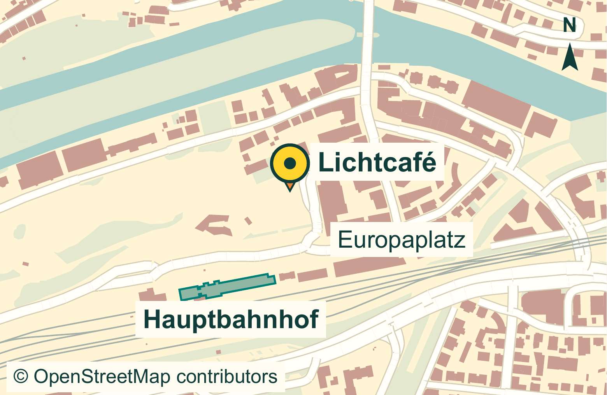

```{r}
#| label: build-location-map
#| include: false
python <- Sys.getenv("MAP_PYTHON")
if (!nzchar(python)) {
  bundled <- path.expand("~/.cache/codex-runtimes/codex-primary-runtime/dependencies/python/bin/python3")
  python <- if (file.exists(bundled)) bundled else Sys.which("python3")
}
result <- system2(python, "build_map.py", stdout = TRUE, stderr = TRUE)
status <- attr(result, "status")
if (!is.null(status) && status != 0) stop(paste(result, collapse = "\n"))
```

{fig-alt="Standortkarte: Das Lichtcafé ist nordöstlich des Tübinger Hauptbahnhofs, westlich des dortigen Europaplatz-Straßenabschnitts markiert. Der Neckar liegt nördlich." width=660}

## Dokumentation

Standortkarte für den Flyer · **66 × 43 mm** · Norden oben. Gebäude sind in Altrosa dargestellt, das Bahnhofsgebäude ist grün hervorgehoben. Die Karte hat keine separate Titel- oder Quellenleiste.

**Exakter Standort:** 48.5171469° N, 9.0566625° E. Die Spitze des Kartenpins liegt auf dieser Koordinate. [Standort in Google Maps öffnen](https://www.google.com/maps?q=48.5171469,9.0566625).

## Datengrundlage und Gestaltung

Die Straßen, Gebäude, Gleise und Wasserflächen stammen aus einem einmalig abgerufenen OpenStreetMap-Ausschnitt. Der Hauptbahnhof wird anhand seines tatsächlichen Gebäudeumrisses hervorgehoben. Die Darstellung ist vereinfacht: ausgewählte Straßen sowie die Ortsbeschriftungen Lichtcafé, Hauptbahnhof und Europaplatz, ohne erfundene Straßen oder Gehroute.

Die Karte verwendet eine lokale equirektangulare Projektion mit Breitenkorrektur bei 48.5171469° N. Der dargestellte Ausschnitt reicht von 9.0515° bis 9.0623° E und 48.5147391417° bis 48.5194° N. Der Ausschnitt wurde innerhalb der gespeicherten OSM-Daten vertikal erweitert, um die Fläche ohne Fußleiste im gleichen geografischen Maßstab zu nutzen. Der vorgegebene Standort liegt ungefähr 126 m nördlich und 84 m östlich des Bahnhofsgebäude-Mittelpunkts; diese Werte sind geometrische Abstände, keine Wegbeschreibung.

**Kartendaten: © OpenStreetMap contributors.** Die Daten stehen unter der Open Database License. [Lizenz und Quellenhinweise](https://www.openstreetmap.org/copyright). Der kurze Urheberhinweis steht innerhalb der Druckkarte am unteren Rand; die ausführliche Provenienz ist hier dokumentiert.

## Reproduzieren und verwenden

`quarto render map/location.qmd` erstellt diese HTML-Vorschau und führt `map/build_map.py` aus. Der Builder benötigt Python mit ReportLab sowie Arial, Fontconfig und Poppler. Er liest ausschließlich den gespeicherten Datenausschnitt; erneutes Rendern benötigt keinen Kartendownload.

- Vektor-PDF: `output/pdf/lichtcafe-standortkarte.pdf`
- PNG mit 600 dpi: `output/preview/lichtcafe-standortkarte.png`
- SVG: `map/output/lichtcafe-standortkarte.svg`
- Originaldaten: `map/data/location.osm`
- Abruf, Prüfsumme, Koordinaten und OSM-Objekte: `map/data/provenance.json`

Das PDF enthält nur die Karte, keine äußere Berichtsseite, Rasterbilder oder Linkannotation. Für den Flyer ist die Einbettung bei 66 mm Breite vorgesehen. Die Ortsbeschriftungen liegen zwischen 7,4 und 8,4 pt; der Quellenhinweis innerhalb der Karte hat 6 pt.
