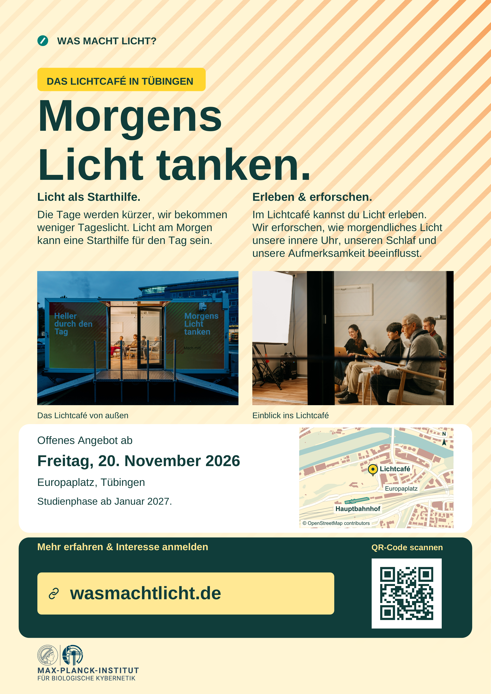

```{r}
#| label: build-concept-flyer
#| include: false
python <- Sys.getenv("FLYER_PYTHON")
if (!nzchar(python)) {
  bundled <- path.expand("~/.cache/codex-runtimes/codex-primary-runtime/dependencies/python/bin/python3")
  python <- if (file.exists(bundled)) bundled else Sys.which("python3")
}
for (script in c("../../map/build_map.py", "../build_flyer_concept.py")) {
  result <- system2(python, script, stdout = TRUE, stderr = TRUE)
  status <- attr(result, "status")
  if (!is.null(status) && status != 0) stop(paste(result, collapse = "\n"))
}
```

::: {.print-notes}
# Das Lichtcafé: A4-Flyer mit Konzepterklärung

Die neue Fassung erklärt den Hintergrund: kürzere Tage, weniger Tageslicht und Licht am Morgen als mögliche Starthilfe für den Tag. Sie verbindet die Einladung ins mobile Lichtcafé mit der Forschung zu innerer Uhr, Schlaf und Aufmerksamkeit. Sie verwendet die Fotos 078 und 092 sowie die Farben und Lichtstreifen des Roll-ups. Eine gestaltete Standortkarte zeigt den genauen Standort beim Hauptbahnhof. Für weitere Informationen und die Anmeldung verweist der Flyer ausschließlich auf Website und QR-Code. E-Mail-Adresse und Fotocredit entfallen auf Wunsch. Frühere Flyer werden beim Erstellen dieser Fassung nicht verändert.

Die Überarbeitung vom 15. November gliedert die Erklärung in zwei kurze Textspalten: „Licht als Starthilfe“ und „Erleben & erforschen“. Beide sind an den darunterliegenden Fotos ausgerichtet. Das Datum steht im Mittelpunkt der Besuchsinformationen; eine gemeinsame weiße Fläche fasst Termine, Ort und Karte zusammen. Der Abschluss bündelt die Handlungsaufforderung.

[A4-PDF öffnen](../pdf/lichtcafe-a4-konzept.pdf){.download}

**Offenes Angebot ab Freitag, 20. November 2026. Studienphase ab Januar 2027.** Weitere Informationen auf der Website.

Dieses Quarto-Notizbuch erzeugt zuerst die Standortkarte aus den lokal gespeicherten Kartendaten und anschließend eine einzelne A4-Seite als PDF. Es prüft Text, Seitenformat, Bildanzahl und Links. Zum Reproduzieren im Ordner `print/concept` ausführen: `quarto render`. Benötigt werden die gleichen Abhängigkeiten wie für den bisherigen Flyer; gemeinsame Gestaltungselemente stammen aus `../build_flyer.py`, die Standortkarte aus `../../map/build_map.py`. Die bisherige A4-/A5-Erzeugung wird nicht aufgerufen.
:::

```{r}
#| label: concept-flyer-preview
#| out-width: 100%
#| fig-alt: "A4-Flyer für das Lichtcafé: Morgens Licht tanken. Der Text erklärt kürzere Tage, weniger Tageslicht und Licht am Morgen als mögliche Starthilfe. Im mobilen Lichtcafé kann man Licht erleben und Forschung zu innerer Uhr, Schlaf und Aufmerksamkeit kennenlernen. Darunter Außen- und Innenansicht, offenes Angebot ab Freitag, 20. November 2026, Studienphase ab Januar 2027, Europaplatz in Tübingen, eine Standortkarte beim Hauptbahnhof sowie Website und QR-Code."

```

::: {.print-notes .design-audit}
## Gestaltungsprüfung · 15. November 2026

Geprüft wurde die aktuelle A4-Fassung in ihrer gerenderten Gesamtansicht sowie anhand der PDF-Geometrie und der gesetzten Textmaße. Schwerpunkt waren Hierarchie, Leseführung, Abstände und die Integration der Karte.

| Befund | Umsetzung |
|:--|:--|
| Der fünfzeilige Erklärungstext hatte keine innere Gliederung; Umbrüche trennten zusammengehörige Formulierungen. | Zwei inhaltlich benannte Spalten unterscheiden saisonalen Anlass und Forschung. Die Zeilen sind kürzer; der Fließtext bleibt mit 13 pt gut lesbar. |
| Vier fett gesetzte Besuchsinformationen konkurrierten miteinander. | Das Datum bleibt mit 19 pt fett der wichtigste Anker. Angebot und Ort stehen in 13 pt normal, der Studienhinweis in 12 pt normal. |
| Besuchsinformationen und Karte sollten stärker als zusammengehöriger Bereich erkennbar sein. | Eine gemeinsame weiße Fläche mit abgerundeten Ecken setzt den gesamten Bereich vom Streifenmuster ab. Sie ist genauso breit wie der darunterliegende Anmeldebereich; die Karte bleibt in voller Größe erhalten. |
| Mehrere Hinweise wiederholten den Verweis auf weitere Informationen. | Eine gemeinsame Aufforderung „Mehr erfahren & Interesse anmelden“ führt zu Website und QR-Code. Der zusätzliche Websitehinweis im Terminblock entfällt. |
| Viele sehr ähnliche Schriftgrößen erzeugten Unterschiede ohne klare Funktion. | Das Hauptlayout nutzt sieben abgestufte Größen: 54, 22, 19, 14, 13, 12 und 10 pt. Kartenbeschriftung und unverändertes Institutslogo werden separat behandelt. |
| Die Karte brauchte eine klarere Trennung zwischen Gebäuden und Hintergrund. | Gebäude sind altrosa, der Hauptbahnhof bleibt farblich hervorgehoben. Die Neckar-Beschriftung und separate Quellenleiste entfallen; ein kleiner Kartencredit bleibt innerhalb der Karte. |

**Raster und Lesbarkeit:** Text- und Fotospalten sind jeweils 86 mm breit und beginnen bei 16 bzw. 108 mm. Die beiden erklärenden Überschriften stehen in 14 pt fett; der Fließtext folgt mit 13 pt und 5,5 mm Zeilenabstand. Der rechte Absatz endet bei 109,9 mm, die Fotos beginnen bei 116 mm. Die ursprünglichen Bildproportionen bleiben erhalten. Die Streifen und kräftigen Kampagnenfarben werden beibehalten.

**Technische Kontrolle:** Eine A4-Seite (210 × 297 mm), zwei Fotos, eingebettete Schriften, eine 66 × 43 mm große Vektorkarte und ein 30 mm großer QR-Code mit vier freien Modulen am Rand. Der Kartenausschnitt verwendet den exakten Standort aus dem gelieferten Google-Maps-Link. Das PDF enthält drei Links: Standortkarte, Website und QR-Code. E-Mail-Adresse, E-Mail-Link und Fotocredit sind nicht enthalten. Die finalen Dateien werden aus diesem Notebook erzeugt; die ältere A4-/A5-Fassung wird nicht aufgerufen.

Diese Prüfung betrifft die digitale Druckvorlage. Die konkrete Farbwiedergabe des Laserdruckers wurde nicht anhand eines physischen Ausdrucks beurteilt.
:::
