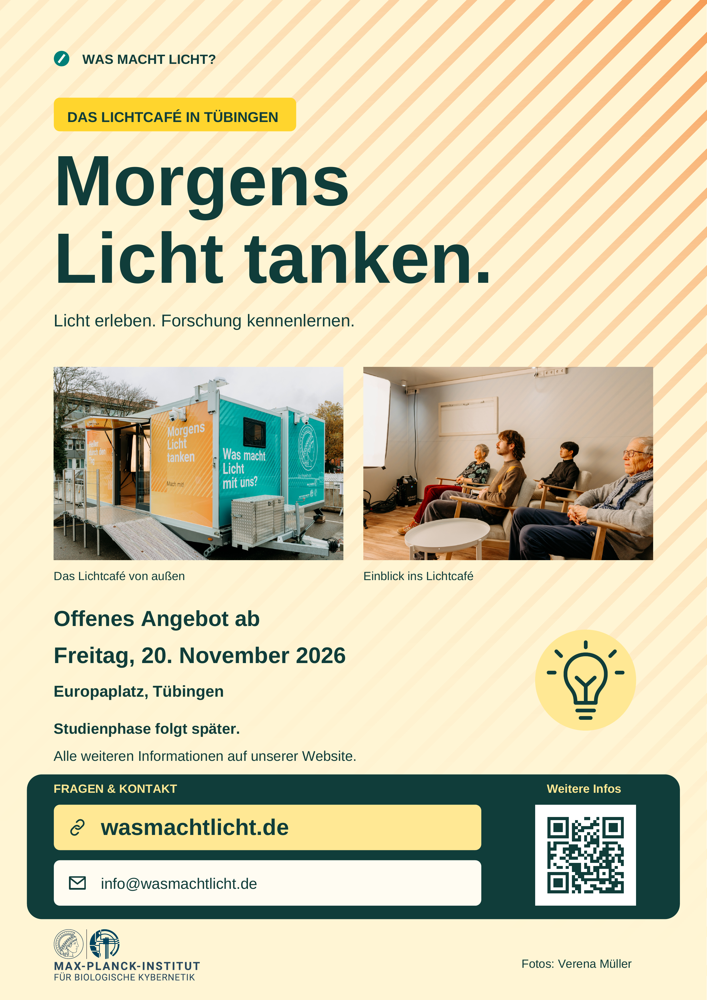

```{r}
#| label: build-print-artifact
#| include: false
python <- Sys.getenv("FLYER_PYTHON")
if (!nzchar(python)) {
  bundled <- path.expand("~/.cache/codex-runtimes/codex-primary-runtime/dependencies/python/bin/python3")
  python <- if (file.exists(bundled)) bundled else Sys.which("python3")
}
result <- system2(python, "build_flyer.py", stdout = TRUE, stderr = TRUE)
status <- attr(result, "status")
if (!is.null(status) && status != 0) stop(paste(result, collapse = "\n"))
```

::: {.print-notes}
# Das Lichtcafé: Fotoflyer in A4 und A5

**Im Stil des aktuellen Roll-ups, mit zwei Fotos:** Der Flyer zeigt das Lichtcafé von außen und innen. Ein durchgehender hellgelber Hintergrund mit orangefarbenen Lichtstreifen, die gelbe Titelplakette, der dunkelgrüne Kontaktbereich und das Glühbirnenmotiv verbinden ihn mit dem Roll-up.

[A4-PDF öffnen](../pdf/lichtcafe-a4-druck.pdf){.download} [A5-PDF öffnen](../pdf/lichtcafe-a5-druck.pdf){.download}

**Offenes Angebot ab Freitag, 20. November 2026. Studienphase folgt später.** Alle weiteren Informationen stehen auf der Website. Beide Druckformate enthalten denselben kurzen Text und zwei Fotografien von Verena Müller. Das Quarto-Notizbuch erzeugt beide PDFs und prüft deren Inhalt und Seitenformat. Zum Drucken das jeweilige Papierformat im Hochformat wählen.
:::

```{r}
#| label: flyer-preview
#| out-width: 100%
#| fig-alt: "Fotoflyer für das Lichtcafé in Tübingen mit einer Außenaufnahme des Trailers und einer Innenaufnahme mit vier Personen vor den Lichtflächen. Morgens Licht tanken. Offenes Angebot ab Freitag, 20. November 2026, Europaplatz, Tübingen. Studienphase folgt später. Alle weiteren Informationen auf wasmachtlicht.de."

```
