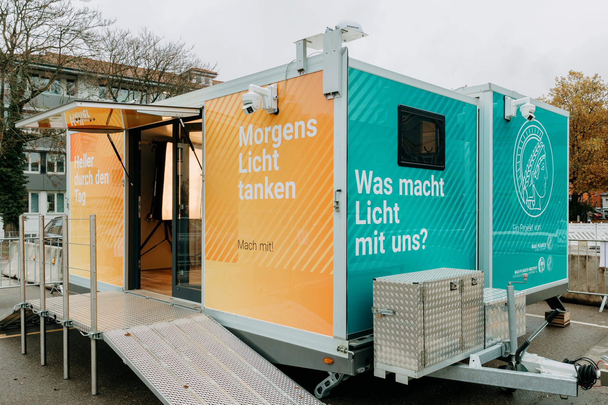
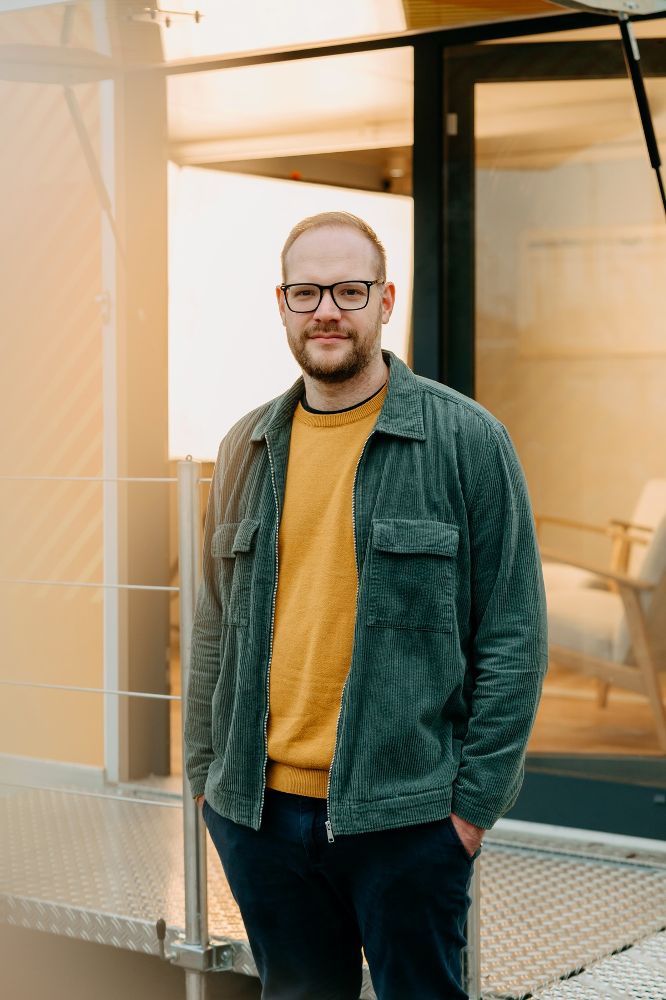
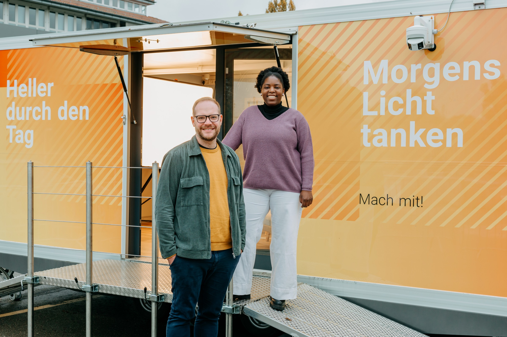
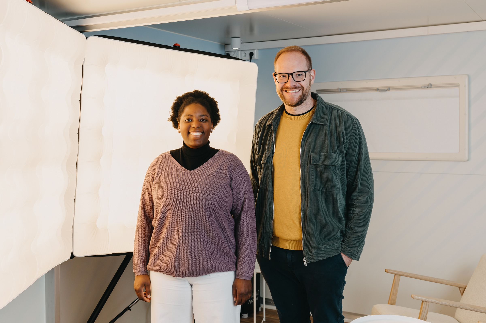

::: {.review-page .trailer-page}

# Das Lichtcafé in Tübingen

Fotografien und Team für **wasmachtlicht.de**

{width=100% fig-alt="Der Forschungstrailer des Lichtcafés."}

**A** Der Trailer des Lichtcafés

Die Aufnahme bildet den Seitenkopf der Projektwebsite.

::: {.photo-source}
Fotografie: **Verena Müller**. Quelle: [Galerie „Max Planck Lichtmobil“](https://www.picdrop.com/verenamuellerfotografie/7e4Z7c46Ma).
:::

:::



::: {.review-page .portrait-page}

# Das Forschungsteam

Max-Planck-Institut für biologische Kybernetik, Tübingen

:::: {.portrait-panels layout="[48,-4,48]" layout-valign="top"}

::: {.portrait-panel}

{width=100% fig-alt="Porträt am Forschungstrailer."}

```{=latex}
\par\vspace{2mm}
```

**B** Porträt am Forschungstrailer

:::

::: {.portrait-panel}

{width=100% fig-alt="Porträt vor dem geöffneten Trailer."}

```{=latex}
\par\vspace{2mm}
```

**C** Porträt vor dem geöffneten Trailer

:::

::::

**Zum Team gehören:** Prof. Dr. Manuel Spitschan (wissenschaftliche Leitung) und Chikondano Daza (wissenschaftliche Mitarbeiterin).

Die Forschungsgruppe Translationale sensorische und zirkadiane Neurowissenschaften untersucht, wie Licht die menschliche Physiologie und das Verhalten beeinflusst.

::: {.photo-source}
Fotos: **Verena Müller** · [tscnlab.org](https://www.tscnlab.org/)
:::

:::



::: {.review-page .team-page}

# Gemeinsam im Lichtcafé

{width=85% fig-alt="Das Lichtcafé-Team am Forschungstrailer."}

**D** Das Team am Forschungstrailer

{width=85% fig-alt="Das Lichtcafé-Team im Lichtcafé."}

**E** Das Team im Lichtcafé

:::
